# Paquito Coach

[](LICENSE)
[](CHANGELOG.md)
[](https://demo-paquito.redgarverde.com)


**Plataforma SaaS para entrenadores personales de fuerza y readaptación y sus clientes.** Nació para Paquito (entrenador CAFYD) como alternativa a Harbiz y desde la 2.0 la puede usar cualquier entrenador: cada uno tiene su estudio, su página pública y su propia cuenta de Stripe.

**[Pruébala en la demo pública →](https://demo-paquito.redgarverde.com)** (un clic, datos inventados que se vuelven a sembrar cada noche)

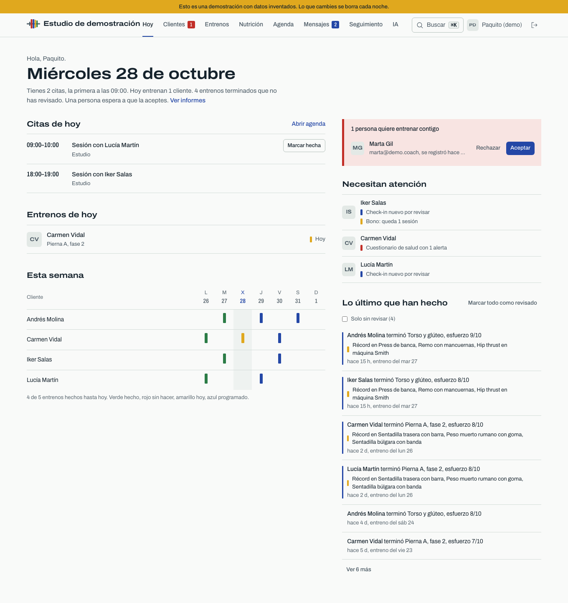

## Dos vistas, una sola app

**Para el entrenador (escritorio)**: panel del día, ficha completa de cada cliente, biblioteca de rutinas y programas, agenda arrastrable y asistente de IA.

| Clientes | Ficha | Agenda | Entrenos |
|---|---|---|---|
| 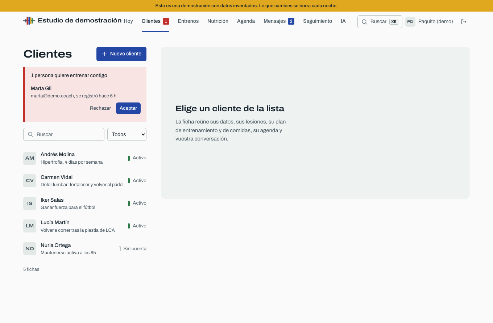 | 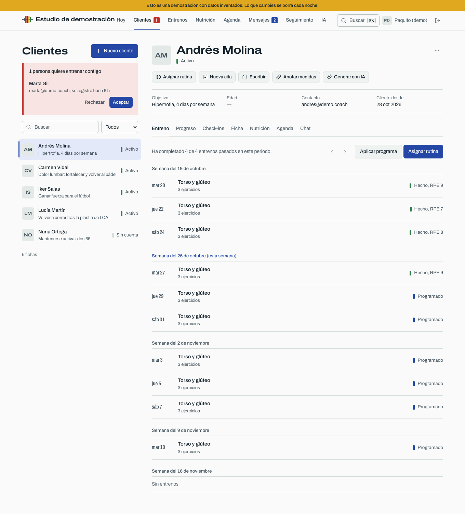 | 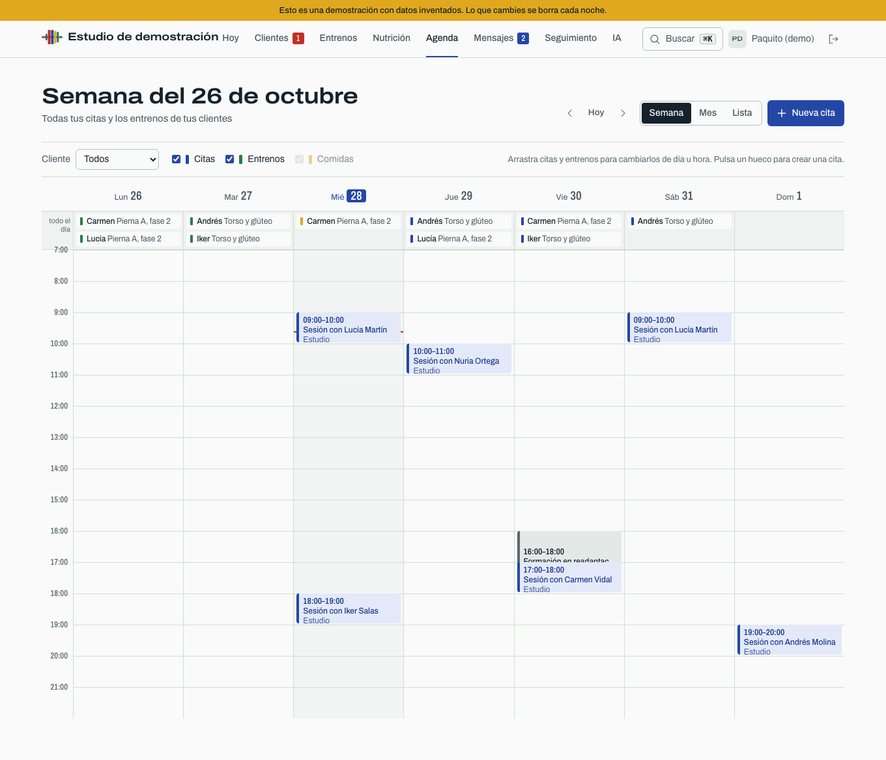 | 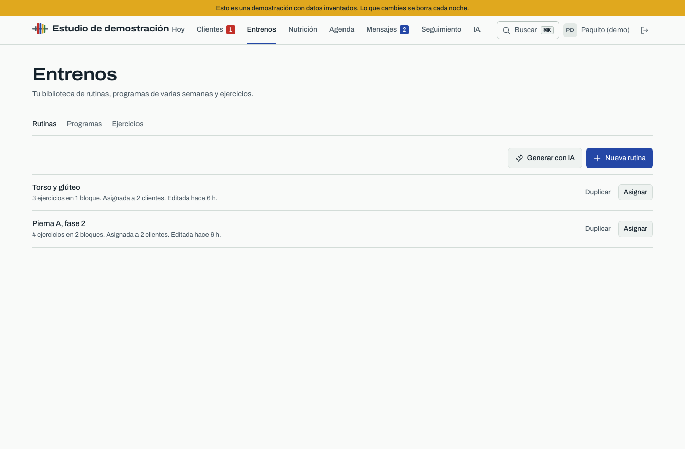 |

**Para el cliente (móvil)**: su entreno de hoy con cuaderno de series, citas, comidas, progreso, check-ins y chat con avisos push.

| Hoy | Entreno (oscuro) | Progreso |
|---|---|---|
| 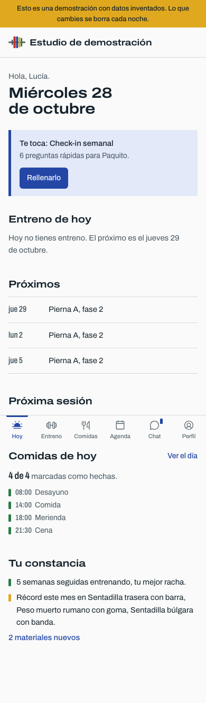 | 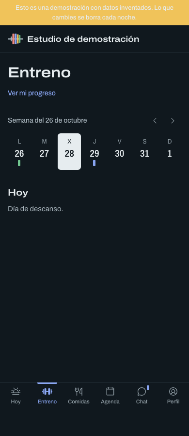 | 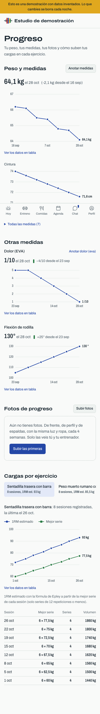 |

<details>
<summary><b>Más capturas</b> (nutrición, IA y acceso a la demo)</summary>

| Planes de comida | Acceso a la demo |
|---|---|
| 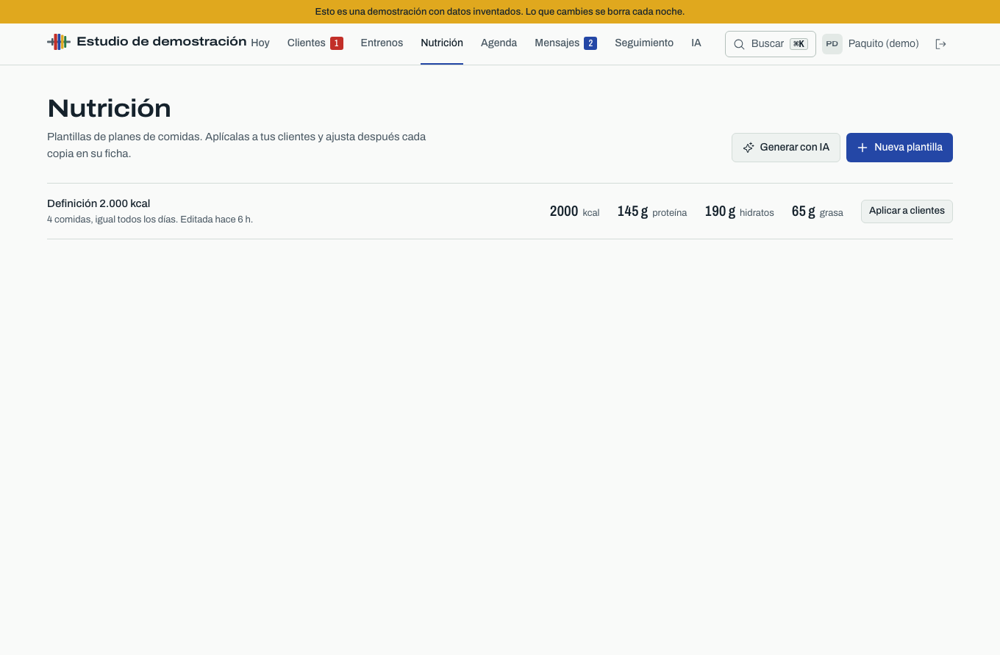 | 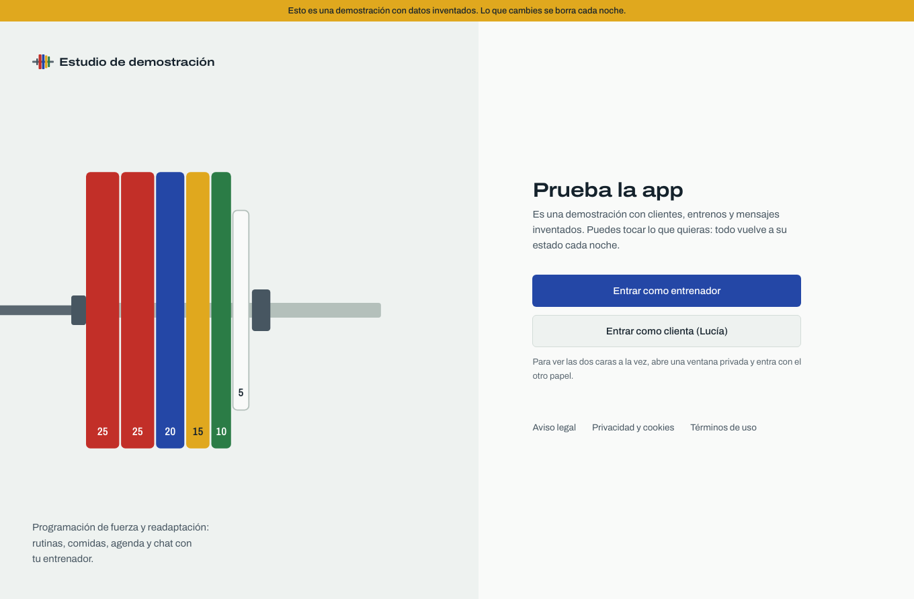 |

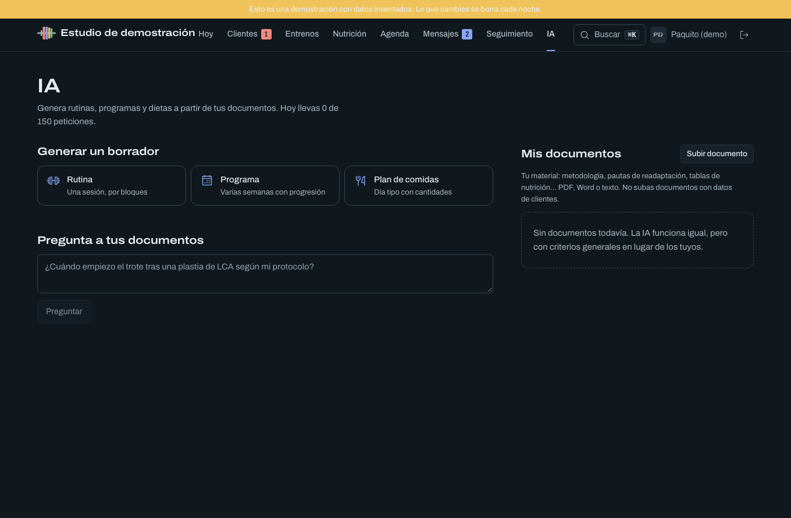

</details>

## Qué incluye

| Área | Funciones |
|---|---|
| 👥 **Clientes** | Alta por invitación, por código del estudio o como ficha sin cuenta. Ficha con lesiones y objetivos, y panel «Hoy» con quién necesita atención. |
| 🏋️ **Entrenamiento** | Biblioteca de ejercicios, rutinas y programas de varias semanas, cuaderno de series con descanso y récord en el momento, 1RM estimado. |
| 🥗 **Nutrición** | Plan de comidas por cliente, con intercambios y comidas marcadas. |
| 📅 **Agenda y cobros** | Agenda semanal, reservas, bonos de sesiones y cobros con Stripe (bonos, cuotas, pago al reservar y enlaces). Cada estudio cobra en su cuenta de Stripe Connect. |
| 📈 **Seguimiento y salud** | Check-ins con formularios propios, fotos y métricas de progreso, PAR-Q+ con alertas e informes. |
| 💬 **Comunicación** | Chat en tiempo real con fotos, avisos push, recordatorios y correo transaccional. |
| 🤖 **IA** | Rutinas, programas y planes de comidas propuestos a partir de los documentos del entrenador (Gemini, datos del cliente seudonimizados). El entrenador revisa antes de guardar. |
| 🏢 **Plataforma** | Alta pública con prueba de 14 días, planes por número de clientes, página por estudio (`/e/<slug>` o dominio propio) y panel de administración. |
| 🔐 **Seguridad y RGPD** | Acceso denegado por defecto, aislamiento por estudio, 2FA, auditoría, exportación y borrado de datos. |

## Cómo funciona

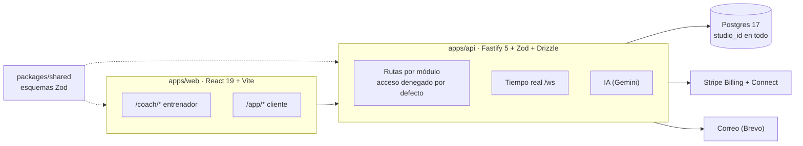

Un solo contenedor sirve la API y la web, y Postgres solo es accesible desde una red interna. La demo es otra instancia con su propia base de datos. Detalle en [arquitectura](docs/arquitectura.md).

| Capa | Tecnología |
|---|---|
| Web | React 19, Vite 8, TanStack Router y Query, Tailwind 4, Radix, Motion |
| API | Fastify 5, `fastify-type-provider-zod`, Zod 4, Drizzle ORM, Postgres 17 |
| Contrato | `packages/shared`: los mismos esquemas Zod validan en la API y tipan la web |
| Tests | Vitest contra Postgres real (293 de API, 77 de web) y Playwright + axe sobre la build de producción (47 e2e + demo) |
| Despliegue | Docker en un VPS casero, detrás de Cloudflare Tunnel, con vuelta atrás automática ([homelab](https://github.com/jlgarciavalverde/homelab)) |

## Empezar

```sh
export PATH="/opt/homebrew/opt/node@22/bin:$PATH"
pnpm install && pnpm db:up && cp .env.example .env && echo SETUP_CODE=dev >> .env
pnpm dev:api & pnpm dev:web     # http://localhost:5173
```

| Comando | Qué hace |
|---|---|
| `pnpm typecheck && pnpm test` | Tipos + tests de API y web |
| `pnpm build && pnpm e2e` | e2e contra la build de producción |
| `pnpm openapi` | Regenera `docs/api/openapi.json` |
| `node tools/deploy.mjs X.Y.Z` | Despliegue de producción y demo ([operaciones](docs/OPERACIONES.md)) |

## Estructura

```
apps/api/src     app.ts, db/schema.ts (única definición de tablas), lib/ (sesión, acceso, Stripe, IA…), routes/
apps/web/src     routes/ (/coach, /app, públicas), components/ui (sistema de diseño), lib/
packages/shared  esquemas Zod y tipos compartidos
e2e/ · e2e-demo/ Playwright
deploy/ · tools/ producción, despliegue, copias y vigilancia
docs/            documentación y ADR
```

## Documentación

Índice completo en [docs/](docs/README.md).

| Para… | Lee |
|---|---|
| Entender el producto | [Requisitos](docs/requisitos.md) · [Flujos](docs/flujos.md) · [MVP](docs/producto/mvp.md) · [Comparación con Harbiz](docs/producto/harbiz-auditoria.md) |
| Entender cómo está hecho | [Arquitectura](docs/arquitectura.md) · [Seguridad](docs/seguridad.md) · [API](docs/api/README.md) · [Decisiones (ADR)](docs/adr/) |
| Diseño visual | [Sistema de diseño](docs/diseno.md) |
| Operar | [Operaciones](docs/OPERACIONES.md) · [Estado](docs/ESTADO.md) · [CHANGELOG](CHANGELOG.md) |
| Programar en el repo | [AGENTS.md](AGENTS.md) |

## Licencia

Todos los derechos reservados desde la 2.3.0: el código se puede consultar, pero no usar, copiar ni desplegar sin permiso. Ver [LICENSE](LICENSE). Las versiones publicadas antes de este cambio se distribuyeron con licencia MIT y conservan esa licencia.
