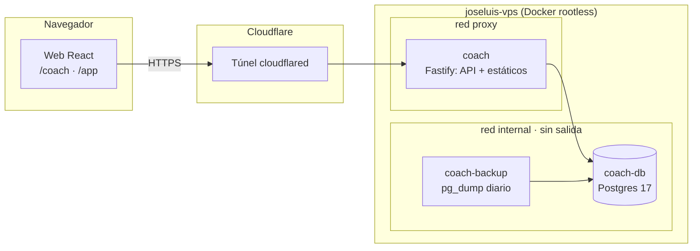
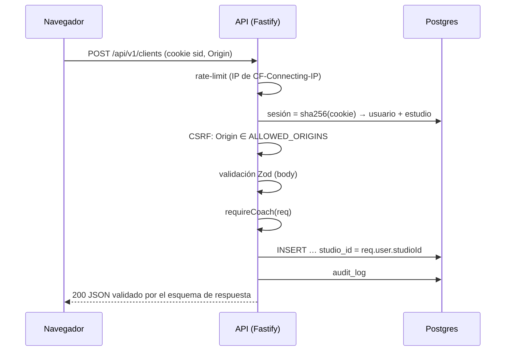
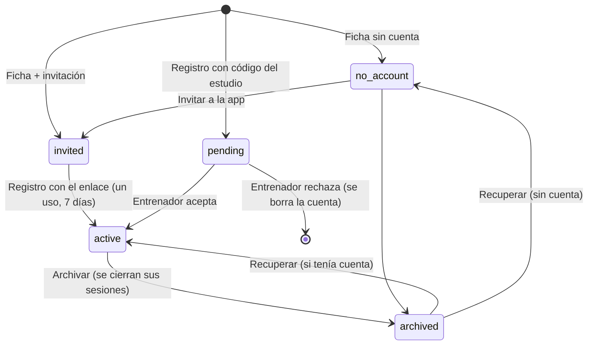
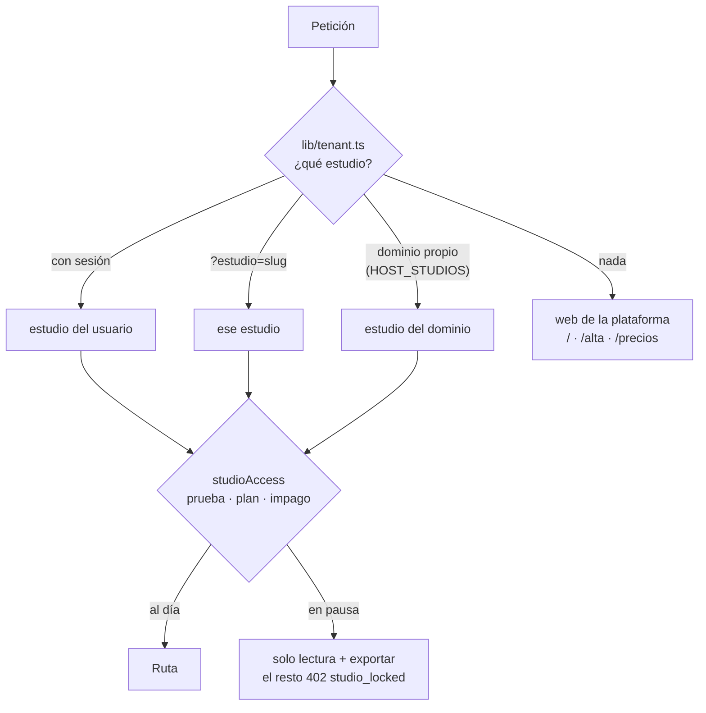
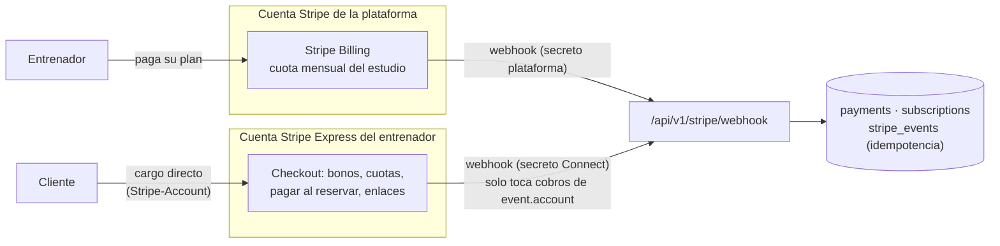
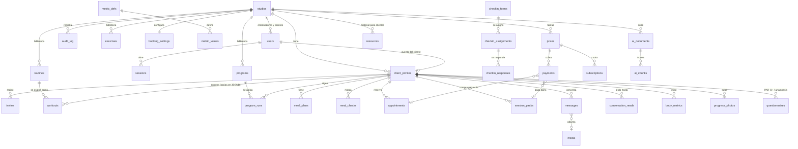
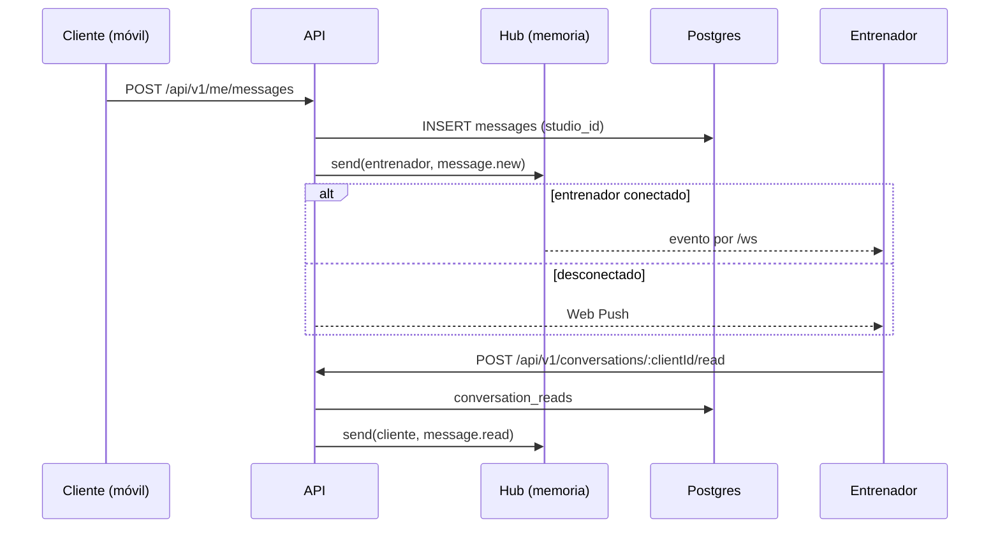

# Arquitectura

## Sistema

- Un solo origen: la API (`/api/v1/*`) y la web estática los sirve el mismo contenedor → **sin CORS**.
- Postgres solo es alcanzable desde la red `internal` (marcada `internal: true`: sin salida a internet). Ningún servicio publica puertos.

## Petición autenticada

## Alta y vínculo de clientes

## Plataforma: varios estudios en una instalación

- Cada estudio tiene su página en `/e/<slug>` y, si quiere, un dominio propio (Paquito: `paquito.redgarverde.com`).
- Planes: prueba de 14 días (5 clientes), básico, pro, estudio y fundador. Solo cambia cuántos clientes ocupan plaza a la vez (ADR 0018).
- Administración de la plataforma en `/coach/admin`, solo para los correos de `PLATFORM_ADMIN_EMAILS`.

## Cobros: dos niveles de Stripe

Sin comisión de la plataforma: cada entrenador cobra en su cuenta y paga la comisión de Stripe (ADR 0019). Los cobros son idempotentes y quedan anonimizados si se borra el cliente (ADR 0015).

## Modelo de datos

42 tablas en `apps/api/src/db/schema.ts`. Todas las de negocio llevan `studio_id`, y el acceso a datos pasa siempre por él (ADR 0004). Por dominios:

| Dominio | Tablas |
|---|---|
| Identidad y acceso | `studios`, `users`, `sessions`, `client_profiles`, `invites`, `password_resets`, `email_tokens`, `audit_log`, `leads` |
| Entrenamiento | `exercises`, `routines`, `workouts`, `programs`, `program_runs` |
| Nutrición | `meal_plans`, `meal_checks` |
| Agenda y bonos | `appointments`, `booking_settings`, `session_packs` |
| Comunicación | `messages`, `media`, `conversation_reads`, `push_subscriptions`, `reminder_log`, `outbox` (correo con reintentos) |
| Seguimiento y salud | `body_metrics`, `progress_photos`, `metric_defs`, `metric_values`, `checkin_forms`, `checkin_assignments`, `checkin_responses`, `questionnaires` |
| Cobros | `prices`, `payments`, `subscriptions`, `stripe_events` |
| IA y material | `ai_documents`, `ai_chunks`, `ai_usage`, `resources` |
| Operación | `error_reports` |

## Tiempo real

`@fastify/websocket` en `/ws`, autenticado con la misma cookie. `lib/realtime.ts` guarda en memoria las conexiones de cada usuario (un solo proceso) y envía eventos tipados de `packages/shared` (`message.new`, `message.read`). Si el usuario no está conectado, el aviso va por Web Push. El socket solo acelera: al reconectar, la web se pone al día por REST, y los contadores de no leídos se refrescan también cada 2 minutos.

