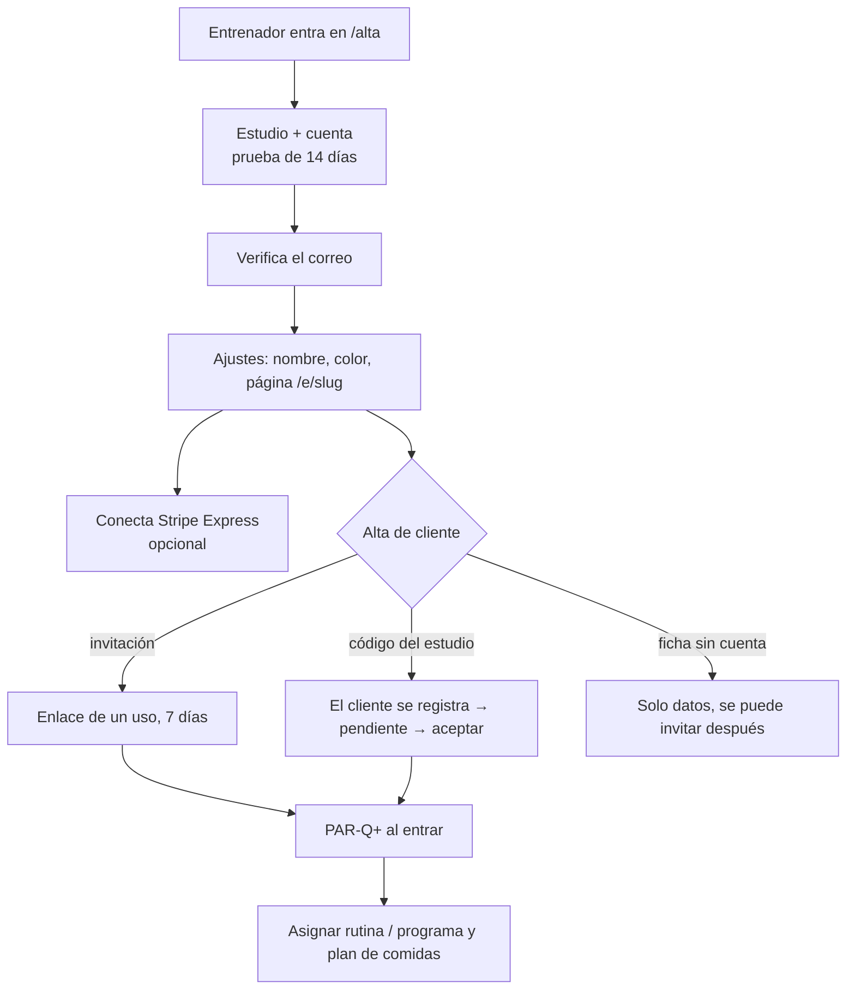
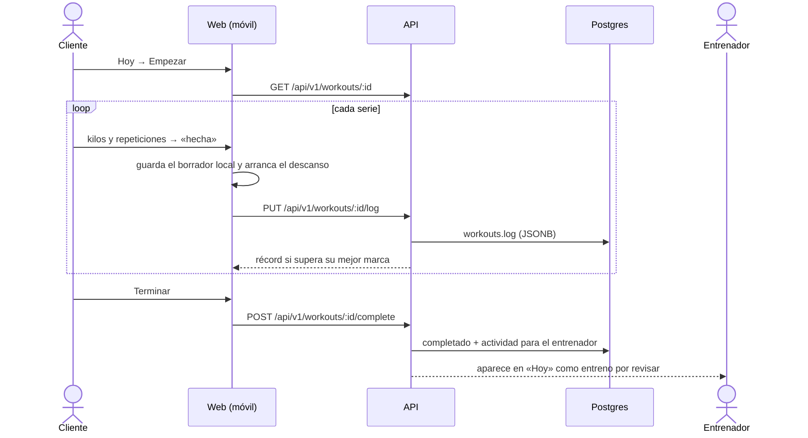
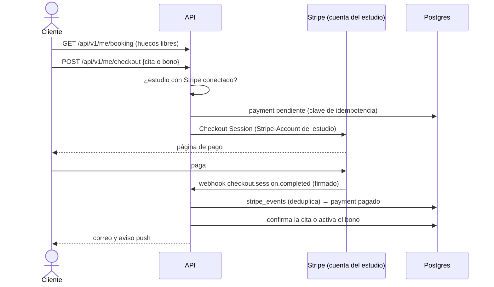
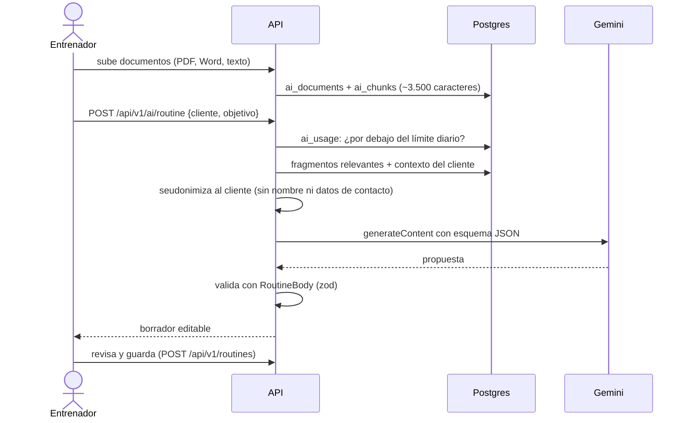
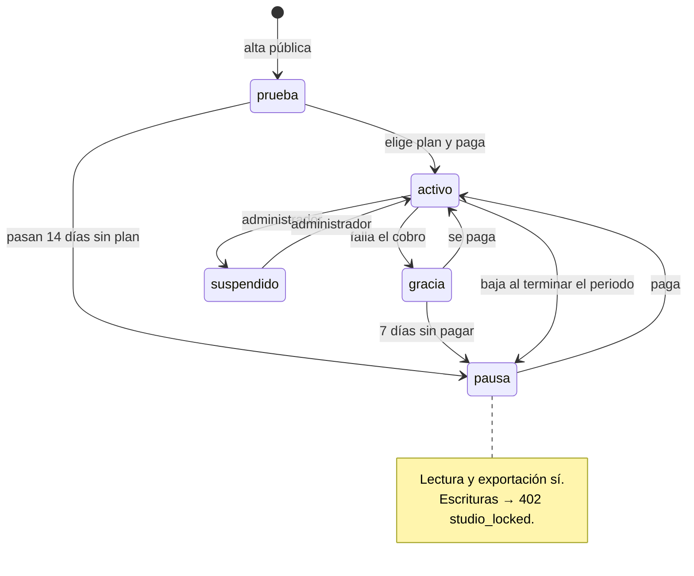

# Flujos principales

Complementa [arquitectura.md](arquitectura.md), donde están la petición autenticada, el ciclo de alta de clientes y el chat en tiempo real.

## Del alta del estudio al primer cliente

## Entreno del cliente (cuaderno de series)

## Reserva con pago

## Propuesta de la IA

## Estudio en pausa

